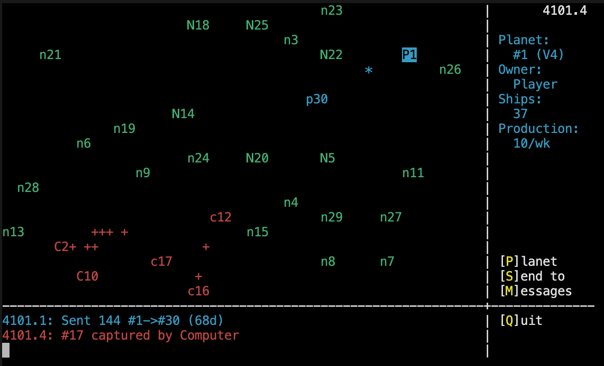

# Empire1

A real-time, single-player terminal strategy game inspired by classic *Empire*, written in Turbo Pascal 3.0-compatible Pascal for **PASTA/80** (CP/M / Z80) and **Free Pascal**.



## Gameplay

Conquer a 30-planet sector against the computer in real time:

- **Planets & fleets:** Capture neutral and computer planets while defending your own. In-transit fleets move in real time, with travel times measured in days (`1` second = `1` day) and ship production measured per week (`/wk`).
- **Difficulty levels** (chosen at startup, default `0`):
  - `0` (**Easy**): Enemy fleets are visible on the map.
  - `1` (**Normal**): Enemy fleets are hidden until detected by your planets' sensors.
  - `2` (**Hard**): Hidden enemy fleets and smarter computer strategy.
- **Victory & defeat:** Eliminating all computer planets and in-transit fleets wins the match (and vice versa). After a match ends, the board stays active so you can stay on it, restart with `R`, or quit with `Q`.

## Controls

- `P` (**[P]lanet**): Select a planet to inspect its details on the right panel.
- `S` (**[S]end to** / **[S]end from**): Send a fleet between planets. Press `Enter` at the ship-count prompt to send all available ships, or `Esc` to cancel.
- `M` (**[M]essages** / **[M]ap**): Toggle between the star chart and recent message history (`Esc` also closes messages).
- `R` (**[R]estart**): Start a new match (confirms while a match is still in progress).
- `Q` (**[Q]uit**): Exit the game (confirms while a match is still in progress).

## Building

Runs in an 80×24 color/ANSI terminal.

### CP/M / Z80 (PASTA/80)

```sh
pasta80 empire.pas
```

Builds `empire.com` (also included pre-built).

### Native (Free Pascal)

```sh
fpc empire.pas
./empire
```

## Source Files

- `empire.pas` — Main loop, player commands, and sensor alerts
- `model.pas` — Galaxy generation, planets, fleets, production, and combat
- `ai.pas` — Computer expansion and reinforcement logic
- `ui.pas` — Terminal UI, star chart, and message log
- `str.pas` — String formatting and conversion helpers
